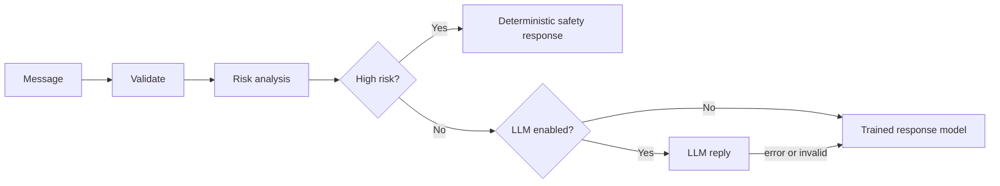
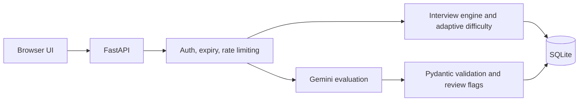

**Python · Machine Learning · Generative AI · Backend Engineering**

I build and test Python/FastAPI backends that add ML and LLM features, with validation, persistence and failure handling built in.

---

## About

My two deployed projects, a safety-first mental health chatbot and a Gemini-powered interview platform, focus on handling AI output responsibly: validating it, falling back safely, and testing the failure paths. I also work with computer vision and NLP, and I'm a final-year B.Tech student looking for internships and fresher roles.

## Recruiter Snapshot

| | |
|---|---|
| **Education** | B.Tech CSE, Mewar University (2023 – 2027, expected) |
| **Target roles** | AI/ML Engineer Intern · Generative AI Engineer Intern · Python Developer · Backend Developer · Entry-level Software Engineer |
| **Core strengths** | FastAPI + Pydantic APIs · SQLite persistence · LLM output validation · scikit-learn text classification · Pytest regression testing |
| **Experience** | AI Intern, iStudio (Oct 2025 – Jan 2026) · AI/ML Industrial Trainee, CTTC (Apr – May 2025) |

---

## Featured Projects

### MindCare AI
**Safety-oriented mental health support chatbot** that keeps risk decisions deterministic and uses ML and LLM components only where it is safe to.

`Python` `FastAPI` `scikit-learn` `TF-IDF` `Docker` `Render`

- **Safety-first routing:** a rule-based behavior/risk engine is authoritative. High-risk messages never reach the LLM, and the trained model's risk output is never used for safety decisions.
- **Trained response model:** TF-IDF + Logistic Regression on a 50,000-message synthetic dataset (20 intents, English + Hinglish) predicting intent, mood, topic and risk.
- **Evaluation discipline:** train/validation/test splits with duplicate and leakage audits, plus hard-negative and challenge-case scripts.
- **Hardening:** session management, CORS validation, an authenticated audit endpoint, and **200+ pytest tests** covering safety, sessions and API security.

**Challenge:** an LLM can produce an unsafe reply to a message in crisis. The risk decision is made first by deterministic rules, and the LLM is gated behind it. If the LLM is off, errors, or returns invalid output, the response falls back to the trained model and templates.

Request flow

Synthetic, non-clinical data. Not clinically validated and not a medical or diagnostic tool.

---

### AI Interview Simulator
**Interview practice platform** with LLM-based answer evaluation, persistent sessions and job-description analysis.

`Python` `FastAPI` `Pydantic` `SQLite` `Gemini API` `JavaScript`

- **Structured evaluation:** Gemini scores answers against a Pydantic schema. Deterministic checks flag answers for human review (very short, off-topic, language mismatch, inconsistent scores).
- **Persistent, secured state:** SQLite-backed interview state and candidate history, separate candidate and session credentials with expiry, and rate limiting with `Retry-After`.
- **Adaptive difficulty:** the next question's difficulty moves with a rolling average of recent scores. Questions come from a curated bank across 3 tracks (Technical, HR, AI/ML) and 3 difficulty levels.
- **JD / résumé analysis:** extracts requirements from a job description and résumé and builds a personalized question plan.
- **76 pytest tests**, using a fake Gemini client so no API key is needed.

**Challenge:** LLM output can be malformed, and network retries can double-score an answer. Malformed output is validated and rejected, provider retries happen only for transient errors, and evaluation requests are idempotent via an `X-Evaluation-Id` header.

Architecture

---

### StudyVerse AI
**AI learning workspace (team project)** where students chat with an AI tutor, generate study packs, flashcards and quizzes, and ask questions over uploaded documents.

`Node.js` `Express` `MongoDB` `JavaScript` `Gemini` `OpenAI` `Groq`

- **Multi-provider AI gateway** over Gemini, OpenAI and Groq, with role-based agents (router, researcher, teacher, critic, synthesizer).
- **Document Q&A (RAG):** document processing and retrieval over uploaded study material.
- **Accounts and data:** JWT authentication with hashed passwords, Mongoose models, and per-user data isolation.
- **Tests:** five backend test files covering security regression, data isolation and API contracts.
- **My contribution:** *(add your specific part here, or delete this line)*

---

### Aishie
**Voice-controlled desktop assistant** (macOS prototype).

`Python` `SpeechRecognition` `OpenCV` `face_recognition` `PyAutoGUI` `AppleScript`

- Face-recognition gate using face embeddings and distance thresholds before the assistant starts.
- Installed-app monitoring with `watchdog` (change log plus a voice command to query it), JSON-based memory, and messaging via AppleScript.
- Requires internet access (Google speech recognition, Wikipedia) and macOS for the automation features.

**Challenge:** spoken transcripts are noisy, so exact string matching misses commands. Wake-word detection and command routing use fuzzy matching to tolerate recognition errors.

---

## Technical Skills

| Area | Hands-on |
|---|---|
| **Languages** | Python, JavaScript, C, C++, SQL |
| **AI / ML** | scikit-learn, TF-IDF, Logistic Regression, NLP, OpenCV, face_recognition, NumPy, Pandas, Keras |
| **Generative AI** | Gemini API, structured output validation, prompt engineering, OpenAI API (optional integration) |
| **Backend & APIs** | FastAPI, REST, Pydantic, token auth, rate limiting, input validation |
| **Databases** | SQLite |
| **Frontend** | HTML, CSS, vanilla JavaScript |
| **Testing & Tools** | Pytest, Git/GitHub, Docker (basic), Render |
| **Exposure** | Node.js, Express, MongoDB (StudyVerse team project), RAG fundamentals |

---

## Experience & Training

**AI Intern** · Internship Studio (iStudio) · *Oct 2025 – Jan 2026*
- Automated recurring data-preprocessing steps in a training pipeline with Python.
- Redesigned LLM prompt templates to enforce a structured output schema.
- Used EDA to identify label noise and class imbalance ahead of deployment.

**AI & ML Industrial Trainee** · CTTC Bhubaneswar · *Apr – May 2025*
- Built a face detection and recognition attendance system (OpenCV, SVM, LBPH) on a self-collected dataset.
- Benchmarked SVM, KNN, Decision Tree and Neural Network classifiers on identical data.

## Education & Certifications

**B.Tech, Computer Science & Engineering**, Mewar University · 2023 – 2027 (expected)

Google AI Essentials · Google Prompting Essentials · IBM SkillsBuild: AI Fundamentals · HP LIFE: Data Science & Analytics

---

## GitHub Activity

  
  

Language percentages reflect repository size, not overall skill.

---

## Contact

