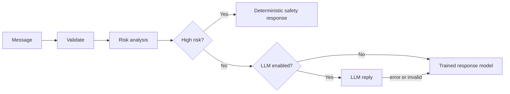
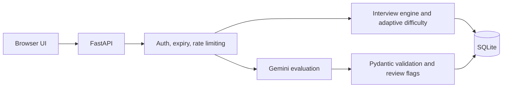

**Python · FastAPI · Generative AI · Machine Learning**

---

## Recruiter Snapshot

| | |
|---|---|
| **Status** | Final-year B.Tech CSE, Mewar University (graduating 2027) |
| **Seeking** | AI/ML Engineer · Generative AI / LLM Applications · Python Developer · Backend Developer (internships and fresher roles) |
| **Core stack** | Python, FastAPI, Pydantic, SQLite, scikit-learn, OpenCV, Gemini API, Pytest |
| **Experience** | AI Intern (Oct 2025 – Jan 2026) · AI/ML Industrial Trainee (Apr – May 2025) |
| **Best projects** | [MindCare AI](#mindcare-ai) (safety-first ML + LLM routing) · [AI Interview Simulator](#ai-interview-simulator) (LLM evaluation + persistent API) |
| **Contact** | [shakyaansh9756@gmail.com](mailto:shakyaansh9756@gmail.com) · [LinkedIn](https://linkedin.com/in/ansh-pratap-68156625b) |

---

## About

I build Python/FastAPI backends that combine machine learning and LLM features with the engineering around them: validated APIs, persistent sessions, authentication, rate limiting, and automated tests. My two deployed projects, a safety-first mental health chatbot and a Gemini-powered interview platform, focus on handling AI output responsibly: validating it, falling back safely, and testing the failure paths.

---

## Featured Projects

### MindCare AI
**Safety-oriented mental health support chatbot** · *Best fit for: AI/ML Engineer, Python/Backend*

`Python` `FastAPI` `scikit-learn` `TF-IDF` `Docker` `Render`

**Problem:** an LLM alone shouldn't decide how to respond to someone in distress. This project keeps risk decisions deterministic and uses ML and LLM components only where they are safe to use.

- **Safety-first routing:** a rule-based behavior/risk engine is authoritative. High-risk messages never reach the LLM, and the trained model's risk output is never used for safety decisions.
- **Trained response model:** TF-IDF + Logistic Regression on a 50,000-message synthetic dataset (20 intents, English + Hinglish) predicting intent, mood, topic and risk, with a deterministic fallback when the optional LLM is off or fails.
- **Evaluation discipline:** train/validation/test splits with duplicate and leakage audits, plus hard-negative and challenge-case scripts.
- **Backend hardening:** session management, CORS validation, an authenticated audit endpoint, and **200+ pytest tests** covering safety, sessions and API security.

Request flow

Built on synthetic, non-clinical data. Not clinically validated and not a medical or diagnostic tool.

---

### AI Interview Simulator
**Interview practice platform with LLM-based answer evaluation** · *Best fit for: Generative AI, Backend*

`Python` `FastAPI` `Pydantic` `SQLite` `Gemini API` `JavaScript`

**Problem:** LLM scores can be inconsistent or malformed. This project validates every evaluation and flags uncertain ones for human review.

- **Structured evaluation:** Gemini scores answers against a Pydantic schema with provider retry. Deterministic checks flag answers for review (very short, off-topic, language mismatch, inconsistent scores).
- **Persistent, secured state:** SQLite-backed interview state and candidate history, separate candidate and session credentials with expiry, rate limiting with `Retry-After`, and idempotent evaluation requests.
- **Adaptive difficulty:** the next question's difficulty moves with a rolling average of recent scores.
- **JD / résumé intelligence:** extracts requirements from a job description and résumé, matches them, and builds a personalized question plan.
- **76 pytest tests**, using a fake Gemini client so no API key is needed.

Architecture

---

### Aishie
**Voice-controlled desktop assistant (macOS prototype)** · *Best fit for: Python, Computer Vision*

`Python` `SpeechRecognition` `OpenCV` `face_recognition` `PyAutoGUI` `AppleScript`

- Wake-word detection and command routing using fuzzy matching, with spoken responses.
- Face-recognition gate using face embeddings and distance thresholds before the assistant starts.
- Installed-app monitoring with `watchdog` (change log plus a voice command to query it), JSON-based memory, and messaging via AppleScript.
- Uses Google's speech API and Wikipedia, so it requires an internet connection.

---

## Technical Skills

| Area | Hands-on |
|---|---|
| **Languages** | Python, JavaScript, C, C++, SQL |
| **Backend & APIs** | FastAPI, REST, Pydantic, token auth, rate limiting, input validation |
| **AI / ML** | scikit-learn, TF-IDF, Logistic Regression, NLP, OpenCV, face_recognition, NumPy, Pandas, Keras |
| **Generative AI** | Gemini API, structured output validation, prompt engineering, OpenAI API (optional integration) |
| **Data & Frontend** | SQLite, HTML, CSS, vanilla JavaScript |
| **Testing & Tools** | Pytest, Git/GitHub, Docker (basic), Render |
| **Exposure** | Node.js, Express, MongoDB (team project), RAG fundamentals |

---

## Experience & Training

**AI Intern** · Internship Studio (iStudio) · *Oct 2025 – Jan 2026*
- Automated recurring data-preprocessing steps in a training pipeline with Python.
- Redesigned LLM prompt templates to enforce a structured output schema.
- Used EDA to identify label noise and class imbalance ahead of deployment.

**AI & ML Industrial Trainee** · CTTC Bhubaneswar · *Apr – May 2025*
- Built a face detection and recognition attendance system (OpenCV, SVM, LBPH) on a self-collected dataset.
- Benchmarked SVM, KNN, Decision Tree and Neural Network classifiers on identical data.

---

## Education & Certifications

**B.Tech, Computer Science & Engineering** · Mewar University, Chittorgarh · 2023 – 2027 (expected)

Google AI Essentials · Google Prompting Essentials · IBM SkillsBuild: AI Fundamentals · HP LIFE: Data Science & Analytics

---

## GitHub Activity

  
  

---

**Open to internships and fresher roles in AI/ML, Generative AI, and Python backend development.**

[LinkedIn](https://linkedin.com/in/ansh-pratap-68156625b) · [Email](mailto:shakyaansh9756@gmail.com) · [GitHub](https://github.com/AnshPratap2314)

