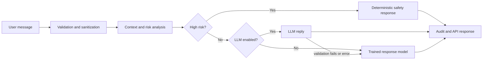
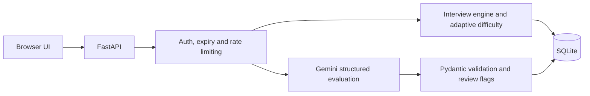

<!-- Banner -->

  

  

    

  
  
  

 

## 👋 About

Final-year **B.Tech CSE** student at **Mewar University** (expected 2027), based in Rajasthan, India.

I build **Python/FastAPI backends that combine machine learning and LLM features** with the engineering around them: validated APIs, persistent sessions, authentication, rate limiting, and automated tests. My recent work is a safety-first mental health chatbot and a Gemini-powered interview platform, both deployed on Render.

> 🎯 **Open to:** AI/ML Engineer · Generative AI / LLM Applications · Python Developer · Backend Developer — internships and fresher roles

---

## 🛠️ Skills

  
  
  
  
  

**Backend & APIs** &nbsp;

**AI / ML** &nbsp;

**Generative AI** &nbsp;

**Testing & Tools** &nbsp;

Exposure: Node.js, Express, MongoDB (team project) · RAG fundamentals

---

## 🚀 Featured Projects

### 🧠 MindCare AI — Safety-Oriented Mental Health Support Chatbot

- **Safety-first routing:** a rule-based behavior/risk engine is authoritative. High-risk messages never reach the LLM, and the trained model's risk output is never used for safety decisions.
- **Trained response model:** TF-IDF + Logistic Regression on a 50,000-message synthetic dataset (20 intents, English + Hinglish) predicting intent, mood, topic and risk, with a deterministic fallback when the optional LLM is off or fails.
- **Evaluation hygiene:** train/validation/test splits with duplicate and leakage audits, plus hard-negative and challenge-case evaluation scripts.
- **Hardening:** session management, CORS validation, an authenticated audit endpoint, and tests covering safety, sessions and API security.

<b>See how a message flows through the system</b>

Synthetic data only. Not clinically validated, and not a medical or diagnostic tool.

 

### 🎯 AI Interview Simulator

- **Structured evaluation:** Gemini scores answers against a Pydantic schema with provider retry. Deterministic checks flag answers for human review (very short, off-topic, language mismatch, inconsistent scores).
- **Persistent state:** SQLite-backed interview state and candidate history, separate candidate and session credentials with expiry, rate limiting with `Retry-After`, and idempotent evaluation requests.
- **Adaptive difficulty:** the next question's difficulty moves up or down based on a rolling average of recent scores.
- **JD / résumé intelligence:** extracts requirements from a job description and a résumé, matches them, and builds a personalized question plan.
- Tests use a fake Gemini client, so no API key is needed.

<b>See the architecture</b>

 

### 🎙️ Aishie — Voice-Controlled Desktop Assistant (macOS prototype)

- Wake-word detection and command routing using fuzzy matching, with spoken responses.
- Face-recognition gate using face embeddings and distance thresholds before the assistant starts.
- Installed-app monitoring with `watchdog` (change log plus a voice command to query it), JSON-based memory, and messaging via AppleScript.
- Uses Google's speech recognition API and Wikipedia, so it needs an internet connection.

---

## 💼 Experience & Training

**AI Intern — Internship Studio (iStudio)** · *Oct 2025 – Jan 2026*
- Automated recurring data-preprocessing steps in a training pipeline with Python.
- Redesigned LLM prompt templates to enforce a structured output schema.
- Used EDA to identify label noise and class imbalance ahead of deployment.

**AI & ML Industrial Trainee — CTTC Bhubaneswar** · *Apr – May 2025*
- Built a face detection and recognition attendance system (OpenCV, SVM, LBPH) on a self-collected dataset.
- Benchmarked SVM, KNN, Decision Tree and Neural Network classifiers on identical data.

---

## 🎓 Education & Certifications

**B.Tech, Computer Science & Engineering** — Mewar University (2023 – 2027, expected)

`Google AI Essentials` · `Google Prompting Essentials` · `IBM SkillsBuild: AI Fundamentals` · `HP LIFE: Data Science & Analytics`

---

## 📊 GitHub Activity

  
  
   
  

---

## 📬 Let's Connect

  
  

